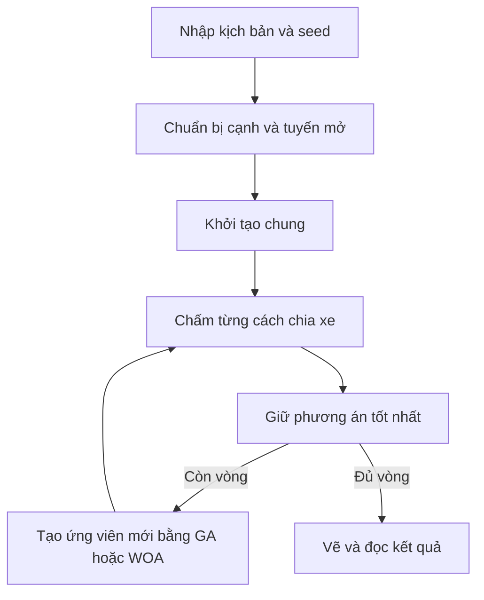

# Đọc code theo đường đi của một phương án

Hãy bắt đầu với `python run.py --case split`. Tưởng tượng nhà xe có hai lối đi. Mỗi tờ giấy ghi vài núm vặn, mỗi núm là mức ưu tiên cho một tuyến. Hàm chấm đọc tờ giấy, đổi núm vặn ra số xe và kiểm tra từng đoạn. GA và WOA khác nhau ở cách viết tờ giấy tiếp theo. Cả hai đều gửi giấy tới cùng một người chấm.

## Từ nút chạy tới hình trên màn chiếu

1. Nút **Chạy GA + WOA** gọi `start_run` trong `app.py`. Hàm đọc số xe, sức chứa, seed, quần thể và số vòng. `make_problem` trong `model.py` giữ một bản dữ liệu riêng cho lượt chạy. Nó đánh dấu tuyến đóng ngay từ đây.
2. `worker` gọi `solver.solve` hai lần. `solver.py` dựng cùng danh sách ứng viên ban đầu bằng `initial_population` trong `algorithms/common.py`. Mỗi thuật toán nhận danh sách của riêng nó nhưng các số ban đầu giống nhau khi seed và cấu hình giống nhau.
3. Trong `algorithms/ga.py` hoặc `algorithms/woa.py`, `solve` tạo ứng viên mới qua các vòng. Mỗi ứng viên gọi `model.evaluate`. Trên mạng chính, hàm này dùng 25 trọng số, chia xe từng tuyến, cộng lên cạnh, tính thời gian và trả bảng điểm `rank`.
4. `checkpoint` giữ ảnh chụp của ứng viên tốt nhất từng gặp tính đến vòng đó. Ứng viên tốt ở vòng 20 vẫn có thể xuất hiện ở vòng 90 nếu chưa tìm ra cái tốt hơn. Trước khi thay đổi ứng viên, hai thuật toán tạo danh sách mới, nên kết quả cũ còn nguyên để xem lại.
5. Giao diện nhận kết quả từ `Queue` rồi gọi `render`. Có thể hình dung form là quầy gọi món và `worker` là bếp. Bếp tính ở luồng riêng, quầy chỉ nhận thông báo và vẽ. Kéo thanh replay chỉ chọn ảnh chụp đã ghi. `views.py` tô màu và vẽ từ số có sẵn.

Đường chạy gọn nhất để đọc code là `run.py` → `solver.solve` → `ga.solve` hoặc `woa.solve` → `model.evaluate`. Mở `app.py` sau khi đã lần được dòng này. Mọi file tính toán đều dùng các kiểu `list`, `dict`, vòng lặp và hàm của Python. Form có một lớp `TrafficApp` để giữ những thứ đang mở trên cửa sổ.

## Người chấm chung trong `model.py`

| Trong code | Nghĩ nôm na |
|---|---|
| `genes` | Các núm vặn ưu tiên. Trên mạng chính, cứ 5 núm lại thuộc một nhóm xe |
| `route_flows` | Sau khi chia bánh, mỗi tuyến nhận mấy miếng |
| `edge_flows` | Xe của mọi tuyến chồng lên từng đoạn. Đây là số để tô màu cạnh |
| `unassigned` và `overflow` | Xe chưa có tuyến, và tổng lượng vượt sức chứa cộng qua các cạnh |
| `rank` | Hai ô chấm lần lượt. So ô vi phạm trước. Nếu ô đầu bằng nhau mới xem xe·phút |
| `total_minutes` | Tổng xe·phút, bằng cách cộng `luồng × phút/xe` ở các cạnh mở |

Thử giữ `problem` của bài nhỏ, thay `genes` từ `[0.6, 0.4]` sang `[0.5, 0.5]`. Mở `route_flows` thấy 60/40 thành 50/50. `edge_flows` sẽ có 4 phần tử vì mỗi tuyến đi qua 2 cạnh. Đây là một cách kiểm tra bằng tay trước khi đổ lỗi cho thuật toán.

## GA làm gì trong một vòng

Mỗi ứng viên là một cách chia xe tiềm năng. `select_parent` bốc 3 ứng viên, có thể bốc lặp, rồi giữ ứng viên có `rank` tốt nhất trong 3. Bốc như thế hai lần để lấy hai bố mẹ. Mỗi ứng viên con có xác suất 0,9 được lai. Với một núm, nếu núm bố là `x`, núm mẹ là `y`, bốc `w` trong `[0, 1]` và đặt núm con là `w × x + (1 − w) × y`. Với `x = 0,7`, `y = 0,3`, `w = 0,25`, núm con là 0,4. Mỗi núm có `w` riêng.

Đột biến xảy ra độc lập ở mỗi núm với xác suất `1 / số núm`. Nếu trúng, cộng một lượng ngẫu nhiên trong `[-0,25, 0,25]` rồi chặn về `[0, 1]`. Có thể hình dung một bạn vẫn làm theo công thức của nhà, lâu lâu thử vặn lửa khác một chút. GA tạo và chấm đủ một quần thể con. Nếu con chưa cải thiện kỷ lục, bản sao ứng viên tốt trước đó có thể thay con kém nhất. Điểm đã biết của bản sao được dùng lại. Nhật ký vẫn đếm đúng số ứng viên mới đã chấm.

## WOA làm gì trong một vòng

`X` là vector trọng số của cá voi đang xét. `X*` là vector tốt nhất gặp từ đầu lượt chạy. `X_rand` là một vector bốc từ quần thể ở vòng trước. Ký hiệu `j` chỉ một núm cụ thể. Mỗi cá voi bốc một bộ số chung cho cả vector. Điều này giúp nhìn một vector như một phương án hoàn chỉnh.

1. Từ vòng 1 tới vòng `G`, hệ số `a` giảm tuyến tính theo `2 × [1 − (vòng − 1) / max(1, G − 1)]`. Với 90 vòng, `a` đi từ 2 đến 0. Với một vòng duy nhất, `a = 2`.
2. Bốc `r₁`, `r₂` và `p` độc lập trong `[0, 1)`. Tính `A = 2 × a × r₁ − a`, `C = 2 × r₂`. Dấu của `A` ảnh hưởng hướng. Độ lớn `|A|` giúp quyết định theo kỷ lục hay đi thăm một cá voi khác.
3. Nếu `p < 0,5` và `|A| < 1`, bao vây. Với từng núm, tính `Dⱼ = |C × X*ⱼ − Xⱼ|`, rồi `X_mới,ⱼ = X*ⱼ − A × Dⱼ`. Ví dụ `Xⱼ = 0,30`, `X*ⱼ = 0,50`, `a = 1,2`, `r₁ = 0,75`, `r₂ = 0,5` thì `A = 0,6`, `C = 1`, `Dⱼ = 0,20`, núm mới bằng 0,38.
4. Nếu `p < 0,5` và `|A| ≥ 1`, khám phá. Bốc `X_rand` trong bầy. Tính `Dⱼ = |C × X_rand,ⱼ − Xⱼ|`, rồi `X_mới,ⱼ = X_rand,ⱼ − A × Dⱼ`. Tưởng tượng tạm hỏi một bàn khác xem họ chia xe ra sao.
5. Nếu `p ≥ 0,5`, xoắn quanh `X*`. Bốc `l` (chữ ell) trong `[-1, 1]`, đặt `b = 1`. Tính `D′ⱼ = |X*ⱼ − Xⱼ|`, rồi `X_mới,ⱼ = X*ⱼ + D′ⱼ × exp(b × l) × cos(2πl)`. `l` là số bốc cho bước xoắn. Với `l = 0`, hai thừa số `exp(0)` và `cos(0)` cùng bằng 1. Nếu dùng lại hai núm 0,30 và 0,50 ở ví dụ trên, núm mới bằng 0,70.
6. Nếu núm mới ra ngoài `[0, 1]`, `clip` kéo nó về 0 hoặc 1. Sau đó mới đổi núm vặn thành xe và chấm tải. Nằm trong biên trọng số và đủ sức chứa là hai phép kiểm tra khác nhau.

Phiên bản này tự viết theo ba nhánh và phương trình của bài báo gốc. Trong ZIP seminar, mã đối chiếu MATLAB dùng khoảng lấy `l` phụ thuộc `a2`, cập nhật tại chỗ và có thể bốc cá voi tham chiếu lại ở mỗi chiều trong nhánh khám phá. Bản giao thông lấy `l` trong `[-1, 1]`, dùng cùng một ảnh chụp bầy cũ và một `X_rand` nguyên vector cho một bước khám phá. Nhóm có thể nói rõ lựa chọn này khi thầy mở cả hai code. [Bài báo gốc WOA](https://doi.org/10.1016/j.advengsoft.2016.01.008) · [ZIP seminar để đối chiếu](https://drive.google.com/file/d/1qIGuMi3yDGBBhXSDfI9M0aPCh-TNhA70/view)

## Biết sửa ở đâu

- Đổi số xe hoặc sức chứa một đoạn trong một lượt demo ở form. Đặt sức chứa 0 để đóng cạnh, rồi chạy lại.
- Tạo một kịch bản cố định trong `data/network.json` bằng cách sao một khối dưới `cases`. `demand` theo thứ tự `pairs`. `capacity` chỉ liệt kê các ID cạnh bị đổi. Giữ mã kịch bản riêng và dành mã `split` cho bài tính tay. Muốn thêm tuyến, kiểm tra đủ cặp nút liên tiếp trong `roads`.
- Đổi số vòng, quần thể và seed ở form hoặc tham số CLI. Nếu dùng cấu hình mới để so sánh, chạy lại cả GA và WOA trên cùng dãy seed và ghi đúng cấu hình ở báo cáo.
- `experiments.py` gom `runs.csv` thành các bảng nhỏ. `make_backup.py` đọc lại các file đó và vẽ ảnh HTML. Chạy `python -m unittest discover -s tests -v` sau khi sửa lõi.

## Khi mở bằng Qt Quick

`qt_demo/main.py` lấy một trong bốn bài toán từ `research/scenarios.py`, gọi cùng `solver.solve` rồi chuyển các khung nghiệm tốt nhất sang QML. QML vẽ bản đồ, đồ thị và chuyển checkpoint. Các bước đọc gene, chấm điểm và kiểm tra ràng buộc vẫn nằm ở lõi Python đã mô tả phía trên.
